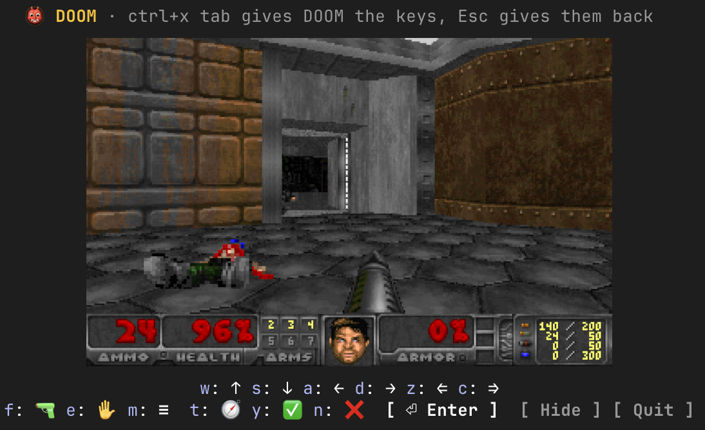

# doom-band

Real DOOM in the band above the Claude Code prompt. Type `/doom` while Claude plans or writes code,
and the doomgeneric engine starts in a child process; its frames are drawn above the prompt with
kitty graphics, and the band's hotkeys drive the game.



## Requirements

- A terminal with the kitty graphics protocol: **Ghostty** or **kitty**. Elsewhere the band shows a
  text line instead of the picture.
- `node` on your PATH (Node 18 or newer). The engine runs in a Node child process, not in Claude Code itself.
- `unzip` (macOS and most Linux distributions have it) for the one-time Freedoom download.
- macOS or Linux.

## Install

At the prompt of a terminal session:

```
/plugin install doom-band --marketplace etrock/doom-band
```

Answer `y` to add the marketplace, then pick a scope (user scope installs it for every session).

From a shell:

```
claude plugin install doom-band --marketplace etrock/doom-band
```

In the desktop app, where `/plugin` does not run: click **+** next to the prompt box, then
**Plugins**, **Add marketplace** with `etrock/doom-band`, then **Add plugin**. The game itself draws
only in a terminal session.

## Play

1. `/doom` starts the engine. The first start downloads the engine build (about 450 KB) and
   Freedoom phase 1 (about 25 MB) into `~/.cache/doom-band/`; later starts are instant.
2. Press **ctrl+x tab** to give the band the keyboard. **Esc** gives it back to the prompt.
3. Keys while the band has the keyboard:

   | Key | Does |
   | --- | --- |
   | `w` / `s` | move forward / back |
   | `a` / `d` | turn left / right |
   | `z` / `c` | strafe left / right |
   | `f` | fire |
   | `e` | use (doors, switches) |
   | `m` | menu (Esc in DOOM) |
   | `t` | automap |
   | `y` / `n` | yes / no in menus |
   | Enter | select in menus (the Enter button holds the focus ring) |
   | `x` | hide the band; the game keeps running |

4. `/doom` shows the band again; `/doom off` (or the Quit button) stops the engine.

Keys are sent as presses that release after 250 ms, so holding a key in the terminal (auto-repeat)
keeps the marine moving. There is no mouse and no sound.

## Settings

Open `/config` and look for the plugin's section:

| Setting | Values | Default | Meaning |
| --- | --- | --- | --- |
| `wad` | absolute path | empty | Your own IWAD (`doom1.wad`, `DOOM.WAD`, `DOOM2.WAD`). Empty downloads Freedoom phase 1. |
| `fps` | `17`, `35` | `17` | Frames per second sent to the terminal. The engine always runs at 35 Hz. |

## How it works

- `bin/doom-host.mjs` runs in Node. It loads the doomgeneric Emscripten build shipped by the
  [`@muhammedaksam/opentui-doom`](https://www.npmjs.com/package/@muhammedaksam/opentui-doom) npm package
  (MIT; doomgeneric and DOOM are GPL-2.0), ticks the engine at 35 Hz, samples the 1280×800 frame buffer
  down to 640×400 RGBA and writes it to a temporary file, then prints `F:<n>` on stdout.
- The hooks module keeps a keyed `Image` in the band and swaps its source with `$.ui.blit` on every
  frame line; the terminal reads the file itself, so no pixel passes through the plugin.
- Hotkey buttons write DOOM key codes to a small JSON file the host polls each tick.
- `/doom off` writes a quit flag; unloading the plugin (a reload, the end of the session) kills the child.

Nothing leaves your machine except the two downloads from jsdelivr and GitHub on first start.

## Development

```
claude plugin validate .
claude plugin test .
npx tsc -p .
```

`.claude-plugin/types/` is written by the engine when the mod loads and is not committed. To run from
the folder while hacking on it: `claude --plugin-dir .`.

## Credits

- [doomgeneric](https://github.com/ozkl/doomgeneric) by ozkl, the portable DOOM.
- [opentui-doom](https://github.com/muhammedaksam/opentui-doom) for the WebAssembly build.
- [Freedoom](https://freedoom.github.io/) for the free game data.
